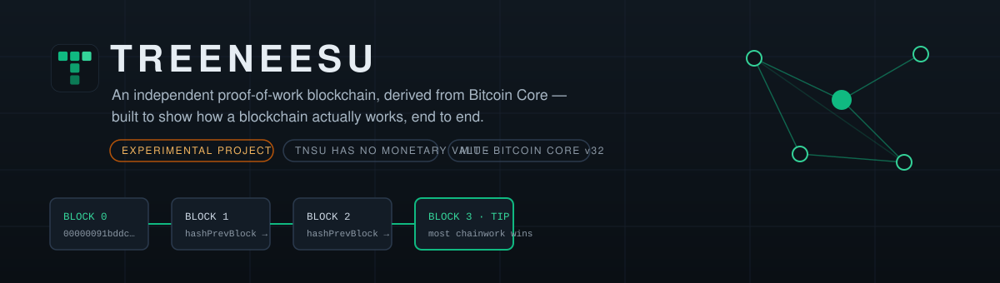
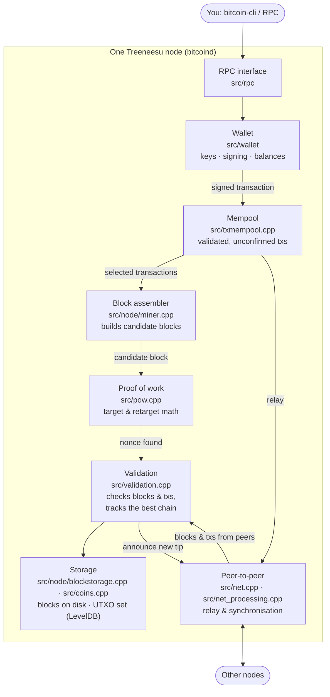
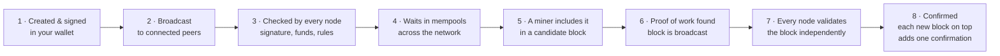
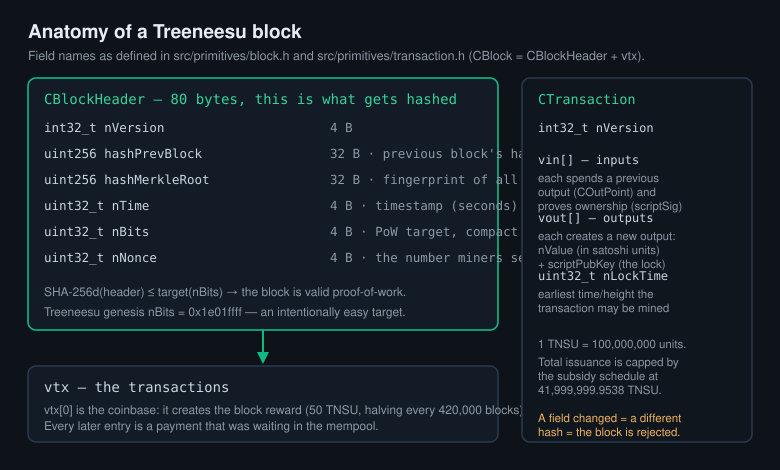
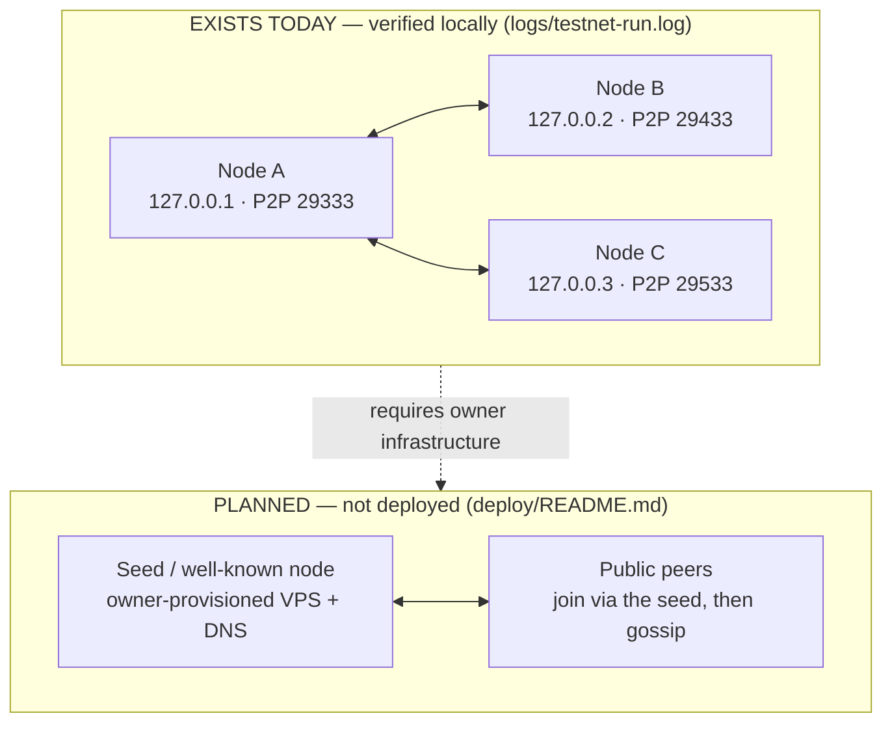

<p align="center">
  
</p>

<p align="center">
  <a href="bitcoin-core/COPYING"></a>
  <a href="PHASE2-DESIGN.md"></a>
  <a href="TEST-SUMMARY.json"></a>
  
</p>

> **Read this first.** Treeneesu is an **educational, experimental** blockchain.
> Its proof-of-work difficulty is intentionally tiny, so its history can be
> rewritten by a single ordinary computer. **TNSU has no monetary value, is not
> traded anywhere, and must never be used for real financial transactions.**
> An independent audit of this codebase concluded: *ready for public
> source-code release only* — see [AUDIT-PRODUCTION-READINESS.md](AUDIT-PRODUCTION-READINESS.md).

## Contents

- [What is Treeneesu?](#what-is-treeneesu)
- [What Treeneesu demonstrates](#what-treeneesu-demonstrates)
- [What Treeneesu does not guarantee](#what-treeneesu-does-not-guarantee)
- [Features](#features)
- [Network parameters](#network-parameters)
- [How it works, in simple words](#how-it-works-in-simple-words)
- [Architecture](#architecture)
- [The life of a transaction](#the-life-of-a-transaction)
- [Anatomy of a block](#anatomy-of-a-block)
- [The network: what exists vs. what is planned](#the-network-what-exists-vs-what-is-planned)
- [Quick start](#quick-start)
- [Build and test](#build-and-test)
- [Project status and known limitations](#project-status-and-known-limitations)
- [Roadmap](#roadmap)
- [Documentation](#documentation)
- [Contributing](#contributing)
- [License and attribution](#license-and-attribution)

## What is Treeneesu?

Treeneesu is a complete, working proof-of-work blockchain built by modifying
**Bitcoin Core v32.0** — the same C++ codebase that runs Bitcoin — and giving
it a new identity: its own genesis block, consensus parameters, network
magic, ports, and address formats. Nothing about it connects to Bitcoin's
network; a Treeneesu node cannot talk to a Bitcoin node, and TNSU is not
Bitcoin.

It exists so that anyone can study a real blockchain from the inside: real
mining, real signatures, real peer-to-peer synchronisation, real consensus
rules — on a chain small and cheap enough to run on a laptop.

The complete production diff against upstream is small enough to read in one
sitting: [PRODUCTION-DIFF.patch](PRODUCTION-DIFF.patch) (5 source files).
Every other change lives in tests, documentation, and tooling, and the exact
commit history ships in `history/treeneesu-commits.bundle`, verifiable
against the public Bitcoin repository.

## What Treeneesu demonstrates

- **A full node, end to end** — block and transaction validation, a mempool,
  wallet key management and signing, mining, and peer synchronisation, all
  from production-grade upstream code.
- **How a fork is actually made** — which constants define a chain's
  identity, which are consensus-critical, and how a one-line parameter
  mistake (see the powLimit defect in [BLOCKERS.md](BLOCKERS.md)) can be
  caught by tests before it ships.
- **Verifiable claims** — every result quoted in this repository links to a
  log, a test summary, or a reproducible command. The genesis block was
  verified three independent ways (source constants, an independent Python
  recomputation, and the compiled daemon).
- **Honest security engineering** — a written threat model, an independent
  production-readiness audit, and a defect-to-regression-test map
  ([DEFECT-REGRESSION-MAP.md](DEFECT-REGRESSION-MAP.md)).

## What Treeneesu does not guarantee

- **Security of funds.** There is no meaningful hashpower protecting this
  chain. Rewriting its history costs minutes on one CPU core
  ([F01-POW-ANALYSIS.md](F01-POW-ANALYSIS.md)). Do not store value in it.
- **A public network.** No public nodes, seed servers, or DNS infrastructure
  exist. Networking is demonstrated locally, between nodes on one machine.
- **Compatibility.** Treeneesu is not Bitcoin, not a Bitcoin testnet, and
  not compatible with Bitcoin wallets, addresses, or tooling.
- **A finished product.** This is a learning artifact under active
  documentation. See [Project status](#project-status-and-known-limitations).

## Features

| Capability | State | Evidence |
|---|---|---|
| Independent chain identity (genesis, magic, ports, addresses) | ✅ Working | [PHASE2-DESIGN.md](PHASE2-DESIGN.md), `genesis/GENESIS-VERIFICATION.md` |
| Mining with real proof-of-work | ✅ Working | `twonode-demo.sh`, `logs/twonode-demo-final.log` |
| Wallets: keys, addresses, payments, backup/restore | ✅ Working | `testnet-run.sh`, `logs/testnet-run.log` |
| Multi-node synchronisation (3 nodes, local) | ✅ Working | `logs/testnet-run.log` — all checks passed |
| Invalid-block rejection | ✅ Working | demo log (nonce-mutated block rejected `high-hash`) |
| Full unit test suite | ✅ 152/152 suites | `logs/final-fullrun/full2.log`, [TEST-SUMMARY.json](TEST-SUMMARY.json) |
| Sanitizer runs (ASan / UBSan) | ✅ Full suite on the final tree: ASan zero errors; UBSan exit 0, one triaged upstream report | `logs/asan-full-f05.log`, `logs/ubsan-full-f05.log` |
| Difficulty-retarget soak (8,070 blocks, two validating nodes) | ✅ Passed 2026-10-24 | `logs/retarget-assert-v2.log` — bits moved exactly as the independent model predicted |
| Auxiliary-chain network isolation (audit F-05) | ✅ Done | source commit `2ecd619`, [BLOCKERS.md](BLOCKERS.md) B2 |
| Public testnet / seed infrastructure | ❌ Not deployed (needs owner-provisioned server + DNS) | `deploy/README.md` |

## Network parameters

| Parameter | Value |
|---|---|
| Genesis hash | `00000091bddca562e9b5a2c98b31e5e5c831ffc015c6fd8853ef18d6df22dfee` |
| Genesis message | `Treeneesu 23/Oct/2026 - a learning chain with no monetary value` |
| Network magic | `a7 3e 5c 91` |
| P2P port / RPC port | 29333 / 29332 |
| Address prefixes | pubkey 65 (`T…`), script 22, WIF 193; bech32 HRP `tnsu` |
| Extended keys | pub `02FE6D4F`, sec `02FE6D47` (unregistered — see [F06-PREFIX-DECISION.md](F06-PREFIX-DECISION.md)) |
| Block subsidy / halving | 50 TNSU / every 420,000 blocks |
| Total issuance | 41,999,999.9538 TNSU (cap enforced by `MAX_MONEY` = 42,000,000) |
| Block spacing / retarget | 150 s target / every 8,064 blocks, Bitcoin's algorithm unchanged |
| powLimit | bits `0x1e01ffff` — ≈ 2²³ expected hashes per block at the easiest difficulty |
| Seed nodes | **none** — peers connect manually with `-addnode` / `-connect` |
| Data dir / config | `~/.treeneesu` / `treeneesu.conf`; user agent `/Treeneesu:32.0.0/` |

## How it works, in simple words

**A block is a group of transactions recorded together.** Each block also
carries the previous block's fingerprint (its hash), which is what chains
blocks into a *blockchain*: change any old block and every fingerprint after
it breaks.

**A transaction is a signed instruction** that says "move this much from
me to that address." Your wallet holds the private keys that produce the
signatures; without a valid signature, every node rejects the transaction.

**Mining is a search.** Miners take the transactions waiting in the mempool
(the waiting room), pack them into a block, and then repeatedly change a
number in the block header — the *nonce* — until the header's hash is below
the network's target. That search is the *proof of work*. On Treeneesu the
target is intentionally easy, so a laptop finds blocks in seconds; Bitcoin's
target is astronomically harder, which is what protects it.

**Nodes trust nobody.** Every node independently checks every block and
every transaction against the same rules. If two versions of history exist,
each node follows the one with the most accumulated proof-of-work
(*chainwork*) — not the one that arrived first, and not one from any central
server. There is no central server.

**Difficulty adjusts itself.** Every 8,064 blocks, the network compares how
long the last period actually took against the 150-second target spacing
and adjusts the target, keeping block times steady as miners come and go.

## Architecture

Treeneesu is Bitcoin Core's architecture with Treeneesu's parameters. The
components below are the real source directories of this repository.



Deeper reading: [docs/ARCHITECTURE.md](docs/ARCHITECTURE.md) and the audit of
the parameter changes in [MISSION4-5-AUDIT-SECURITY.md](MISSION4-5-AUDIT-SECURITY.md).

## The life of a transaction



A transaction that fails step 3 is dropped and never relayed. A block that
fails step 7 is rejected — the demo proves this by mutating a nonce and
watching the peer answer `high-hash`.

## Anatomy of a block

<p align="center">
  
</p>

## The network: what exists vs. what is planned



Today, nodes find each other only because a human tells them to
(`-addnode`). There is deliberately no seed infrastructure: Treeneesu's main
network ships with Bitcoin's seed lists *deleted*, so the binary can never
accidentally join or depend on another network's infrastructure.

## Quick start

Build, then run a node, mine a few blocks, and make a payment — every
command below was executed against the binaries built from this repository.

```sh
# 1 · Build (Ubuntu 24.04)
sudo apt-get install -y build-essential cmake libboost-dev libsqlite3-dev
cd bitcoin-core
cmake -B build -DBUILD_GUI=OFF -DENABLE_IPC=OFF \
      -DCMAKE_CXX_FLAGS_RELWITHDEBINFO="-O2 -g0"
cmake --build build -j 2 --target bitcoind bitcoin-cli test_bitcoin

# 2 · Run a node and mine (from bitcoin-core/)
./build/bin/bitcoind -daemon -fallbackfee=0.001
CLI="./build/bin/bitcoin-cli"
$CLI getblockhash 0            # → 00000091bddca562… (the genesis above)
$CLI createwallet miner
ADDR=$($CLI getnewaddress)     # → tnsu1… (bech32) or T… (base58)
$CLI generatetoaddress 3 "$ADDR" 2000000000   # mine 3 blocks, real PoW
$CLI getbalance                # coinbase rewards mature after 100 blocks
$CLI sendtoaddress <address> 25
$CLI getblockcount
$CLI stop
```

Two scripted demonstrations are included and have recorded passing runs:

```sh
./twonode-demo.sh    # two nodes: sync, payment, invalid block rejected, restart recovery
./testnet-run.sh     # three nodes: 105 blocks, 10 TNSU transfer, wallet backup & restore
```

Binaries are still named `bitcoind` / `bitcoin-cli` and the startup banner
still prints "Bitcoin Core version" (cosmetic; [BLOCKERS.md](BLOCKERS.md)
B6). The running node's identity is Treeneesu's — check
`getnetworkinfo`: subversion `/Treeneesu:32.0.0/`.

## Build and test

```sh
# unit tests — 152 suites, all passing on the audited tree
./build/bin/test_bitcoin
# (script_assets_tests self-skips with a warning when DIR_UNIT_TEST_DATA
#  is unset — stock upstream behaviour, not a failure)

# functional subset
python3 test/functional/test_runner.py feature_help rpc_net wallet_basic \
        p2p_v2_transport feature_segwit rpc_blockchain
```

Full evidence, including the sanitizer runs and the retarget soak's live
status, is in [TEST-SUMMARY.json](TEST-SUMMARY.json) and `logs/`.

## Project status and known limitations

**Status (2026-10-23):** local network fully working; independent audit
verdict **B — public source-code release only**. Open items, honestly:

- **Weak proof-of-work (permanent, by design).** ≈ 2²³ hashes per block.
  History rewrite is trivial; no confirmation count fixes this
  ([THREAT-MODEL.md](THREAT-MODEL.md) §5). A value-bearing chain would
  have to be a *successor* chain with real, committed hashpower.
- **Retarget soak: passed (2026-10-24).** The 8,070-block live-consensus
  test completed with every assertion matching the independent model
  (`logs/retarget-assert-v2.log`); audit Gate B is met. Its first attempt
  failed at block 1 — a bug in the test grinder, caught by the node's own
  validation — and that history is preserved in the repository.
- **No public network.** Nothing is deployed; seed infrastructure is
  owner-gated (`deploy/` contains the prepared, unprovisioned package).
- **Auxiliary chain classes are legacy.** `-chain=test` etc. carry
  inherited upstream chain parameters in unsupported classes; their
  *network identity* was isolated in the F-05 patch (Treeneesu magic,
  ports, Bitcoin seeds deleted) so this binary cannot join Bitcoin's
  auxiliary networks.
- **Single-author test repairs.** The 21 test repairs from the initial
  audit are documented and payload-preserving, but have had no independent
  human review. Neither has this README's author — the auditor is the
  developer. Treat all claims through the linked evidence, not through
  trust.
- **Cosmetics.** Binary names and the version banner still say Bitcoin
  Core ([BLOCKERS.md](BLOCKERS.md) B6).

## Roadmap

**Done**
- Chain design, genesis, and parameter verification (three-way)
- powLimit defect found by tests, fixed, and re-verified
- Full unit suite green; two-node demo; three-node private testnet
- ASan/UBSan subsets clean; production-readiness audit (verdict B)
- Threat model; F-05 network isolation; F-04 deployment package;
  F-06 prefix decision; min-chain-work tool (live-tested)
- 8,070-block retarget soak passed with two-node assertions (Gate B met)
- Full-suite ASan (zero errors) and UBSan (exit 0, one triaged upstream
  report) runs on the final tree
- This documentation pass

**In progress**
- Nothing engineering-side; the remaining items are owner decisions
  (below)

**Planned / owner decisions**
- Public experimental testnet — requires the owner to provision a seed
  host and DNS (`deploy/README.md`); no date is promised
- Extended-key prefix registrations (SLIP-0132 / SLIP-0173 drafts are
  prepared in [F06-PREFIX-DECISION.md](F06-PREFIX-DECISION.md))
- Any successor, value-bearing chain — a separate project decision, with
  its own design review and audit; not a configuration change to this one

## Documentation

| Document | What it covers |
|---|---|
| [docs/BEGINNER-GUIDE.md](docs/BEGINNER-GUIDE.md) | Start here if blockchains are new to you |
| [docs/ARCHITECTURE.md](docs/ARCHITECTURE.md) | Component-by-component architecture |
| [docs/COMMANDS.md](docs/COMMANDS.md) · [docs/RUNBOOK.md](docs/RUNBOOK.md) | CLI reference and operating procedures |
| [PHASE2-DESIGN.md](PHASE2-DESIGN.md) | Every parameter decision, and why |
| [THREAT-MODEL.md](THREAT-MODEL.md) | What this chain can and cannot withstand |
| [AUDIT-PRODUCTION-READINESS.md](AUDIT-PRODUCTION-READINESS.md) | The independent audit and its verdict |
| [DEFECT-REGRESSION-MAP.md](DEFECT-REGRESSION-MAP.md) | Every defect and the test that guards it |
| [TESTNET-GUIDE.md](TESTNET-GUIDE.md) | Running the multi-node demonstration |
| [SECURITY.md](SECURITY.md) | Reporting a vulnerability; accepted limitations |
| [BLOCKERS.md](BLOCKERS.md) | The honest list of what remains open |

## Contributing

Contributions that fit the project's purpose — learning, correctness,
documentation, tests — are welcome.

- **Never fake a result.** If a test wasn't run, say so. If it failed,
  show the failure. Every claim in this repository links to evidence;
  keep it that way.
- **Never weaken, skip, or delete a test to make it pass.** If a test
  disagrees with a parameter change, the parameter change is what gets
  justified — in writing, against an independent derivation.
- **Preserve upstream notices.** All Bitcoin Core copyright and license
  text stays exactly as shipped.
- **Scope.** Changes that present TNSU as valuable, tradable, or safe for
  real funds are out of scope by definition and will not be merged.
- There is no CLA and no code of conduct beyond the rules above and
  ordinary decency.

## License and attribution

Treeneesu is a derivative of **Bitcoin Core**, © Bitcoin Core developers,
2009–2026, released under the **MIT License** (see
[bitcoin-core/COPYING](bitcoin-core/COPYING)). All upstream copyright and
license notices are preserved throughout the source tree. Treeneesu's own
changes are offered under the same MIT terms.

"Treeneesu" and "TNSU" are project names for this educational experiment.
They imply no affiliation with Bitcoin, the Bitcoin Core project, or any
other project — and no promise that the software is fit for any purpose
beyond study.
